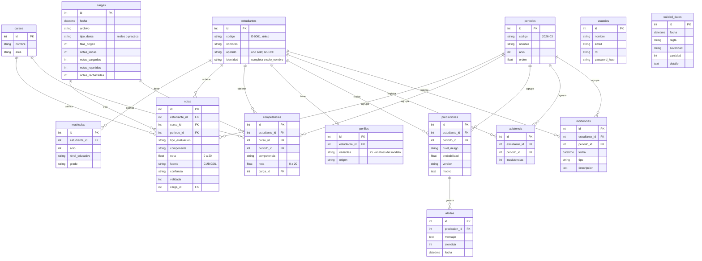

# Modelo entidad-relación de la base de datos

Actividad A-2.1.1.2 del cronograma (paquete 1.2.1, entregable E-01). El diagrama sale de la definición de las tablas en `backend/etl/modelo_datos.py`, que sirve igual para PostgreSQL (producción) y SQLite (pruebas locales). Versión del 15/11/2026, con la tabla `competencias` (SC-14). Este documento no contiene datos de ningún estudiante.

## Diagrama

`perfiles` tiene en realidad 25 columnas, una por variable del modelo (sexo, edad, familia, hábitos, inasistencias…); en el diagrama se resumen en una.

## Tablas

| Tabla | Para qué | Filas en la base real al 15/11/2026 |
|---|---|---|
| `estudiantes` | Un registro por estudiante con su código único. Los nombres solo existen en la base privada. | 50 |
| `matriculas` | Año, nivel y grado de cada estudiante (cambia cada año). | 50 |
| `cursos` | Catálogo de cursos con su área. | 7 |
| `periodos` | Meses del año escolar, ordenados. | 6 (marzo a agosto de 2026) |
| `notas` | Promedio de cada curso en cada mes, con su fuente y su carga. | 807 |
| `competencias` | Promedio de cada competencia del curso en el mes (SC-14). | 2 892 |
| `cargas` | Bitácora de cada carga de datos: archivos, filas, notas cargadas, repetidas y rechazadas. | 5 |
| `calidad_datos` | Resultado de cada regla en cada ejecución de la validación. | 40 |
| `perfiles` | Variables del modelo que no son notas. | 50 |
| `predicciones` | Nivel de riesgo y probabilidad de cada estudiante en su último periodo. | 49 |
| `alertas` | Alertas generadas a partir de las predicciones (Sprint 4). | 0 |
| `asistencia` | Inasistencias por periodo (sin datos digitales todavía). | 0 |
| `incidencias` | Incidencias de conducta (sin datos digitales todavía). | 0 |
| `usuarios` | Cuentas con su rol: administrador, dirección, coordinación y docente (Sprint 4). | 0 |

## Reglas de integridad

- Un estudiante no puede tener dos notas del mismo curso, periodo, tipo y componente (`uq_nota`), ni dos promedios de la misma competencia en el mismo curso y periodo (`uq_competencia`).
- Las notas y competencias van de 0 a 20; los componentes, tipos de evaluación y niveles de riesgo solo aceptan los valores del catálogo.
- Al borrar un estudiante se borran sus notas, competencias, matrículas, perfil y predicciones (borrado en cascada).
